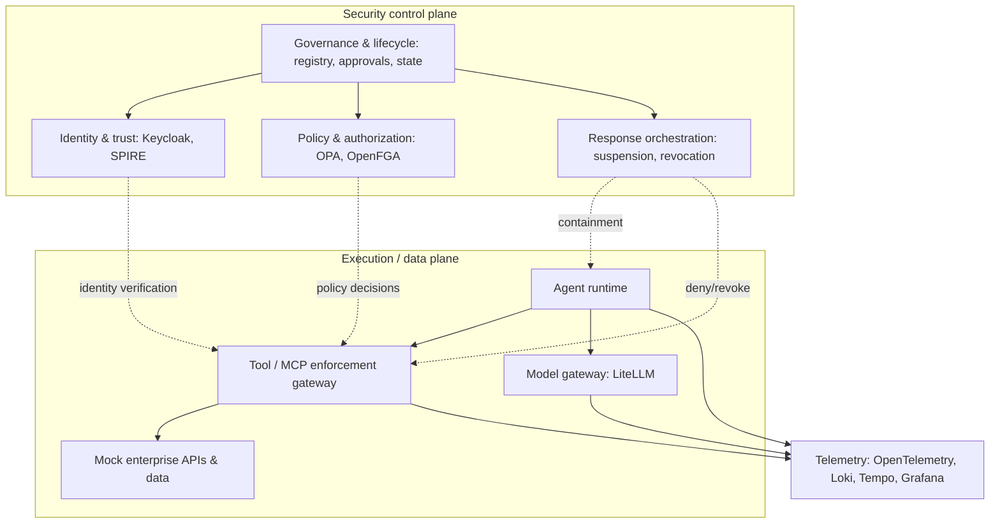

# Enterprise Agent Security

An open-source, vendor-neutral framework for securing AI agents across their entire lifecycle, with practical Docker-based security labs.

> **Status:** Early foundation / architecture draft. No production-readiness claims. Labs use synthetic data and isolated environments.

## Development roadmap

The project is evolving into an interactive agent security playground with manual labs, real automated autopilot runs, sandbox control toggles, live topology and an evidence scorecard. See the [incremental development roadmap](ROADMAP.md) for small work packages, dependencies, acceptance criteria and the next recommended task. All labs follow the [cross-platform standard](docs/labs/cross-platform-standard.md).

## Two views of agent security

1. **Lifecycle view:** Discover and register → assess and approve → provision identity → authorize and deploy → execute → observe and respond → review → retire.
2. **Architecture view:** The **control plane** governs and coordinates trust and policy; the **data plane** executes agent work and enforces decisions at runtime boundaries.

See [Control plane vs. data plane](docs/architecture/control-plane-vs-data-plane.md), [Lifecycle](docs/architecture/agent-lifecycle.md), and [Reference architecture](docs/architecture/reference-architecture.md).

## Architecture at a glance

**Important:** The diagram separates *logical responsibility* from deployment location. The gateway is in the data plane but acts as a **policy enforcement point (PEP)**. OPA provides decisions, not enforcement by itself. Observability spans both planes. The model gateway is not a substitute for tool-level authorization.

## Intended audiences

- **Architects:** understand trust boundaries and enterprise integration patterns.
- **Engineers:** run reproducible labs and implement controls.
- **Governance:** map controls to objectives, ownership, and evidence.
- **Leadership:** see which controls have actually been tested.

## Project structure

- `docs/architecture/` — lifecycle, planes, trust boundaries, diagrams
- `docs/controls/` — foundational and advanced control catalog design
- `docs/labs/` — lab progression and validation requirements
- `labs/` — Lab 01 user-validated on Windows; [Lab 02 SPIRE](labs/02-spiffe-spire/README.md) experimental scaffold; [Lab 03 OpenBao](labs/03-openbao/README.md) unverified exercise
- `infrastructure/` — Docker Compose configuration and lab integrations
- `dashboard/` — interactive playground, live lab execution and evidence scorecard (planned)

## First milestone

Demonstrate **register → approve → authenticate → authorize → act → observe → suspend** with a synthetic customer-record API. Test unregistered, unapproved, unauthorized, suspended, and fail-closed scenarios. The initial build will use Docker Compose, Keycloak, OPA, a registry API, a tool enforcement proxy, and OpenTelemetry. SPIRE and OpenBao have separate experimental Compose overlays; their integration with the Lab 01 gateway remains future work.

## Principles

- **Deny by default** at protected action boundaries.
- **Separate identity, authorization, and lifecycle state.**
- **Never trust an agent's own instructions to enforce permissions.**
- **Suspension must deny actions even while previously issued credentials remain valid.**
- **Evidence is not effectiveness:** tests must verify control behavior.
- **No real secrets, customers, or production integrations in labs.**

## Contributing

Architecture and control definitions are being established. Contributions and issue reports are welcome; please do not submit real credentials, customer data, or unredacted security logs.
