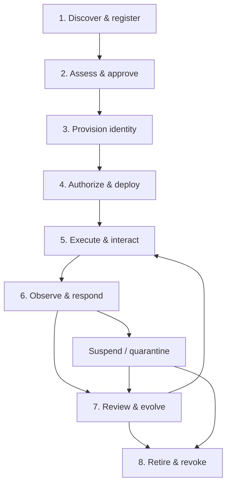

# Enterprise agent lifecycle

The lifecycle describes **when** security decisions occur; the plane model describes **where** decisions and enforcement occur.

Observability, identity validation, authorization, and governance are continuous, not one-time checkpoints.

| Stage | Control-plane responsibility | Data-plane responsibility | Evidence |
| --- | --- | --- | --- |
| Discover/register | Assign stable ID, owner, purpose, inventory record | No protected actions yet | Registry entry |
| Assess/approve | Classify risk, approve capabilities | No execution until approved | Approval decision |
| Provision identity | Bind identity to approved workload | Prove identity on requests | Authentication event |
| Authorize/deploy | Publish least-privilege policies | Enforce at gateways/APIs | Policy version and deployment |
| Execute/interact | Evaluate contextual authorization | Perform allowed tool/model calls | Tool trace and decision |
| Observe/respond | Detect, suspend, revoke, coordinate containment | Block, isolate or stop actions | Incident and enforcement evidence |
| Review/evolve | Revalidate owner, capabilities, identity, policy | Roll out reviewed version | Recertification and change record |
| Retire/revoke | Mark retired, remove permissions and trust | Stop runtime, deny remaining requests | Revocation and retirement tests |

## Three separate state machines

- **Registry:** draft → pending approval → approved → active → suspended → retired
- **Identity:** unprovisioned → active → rotated/revoked
- **Runtime:** stopped → running → quarantined/terminated

Do not assume a transition in one state machine automatically completes the other two. Lifecycle orchestration must reconcile states and produce evidence of success or failure.

## First end-to-end demonstration

A registered read-only analyst agent retrieves a synthetic record, attempts an unauthorized deletion, and is then suspended. Its read succeeds before suspension, deletion is denied, and all subsequent protected actions are denied after suspension, including with an otherwise valid token.
