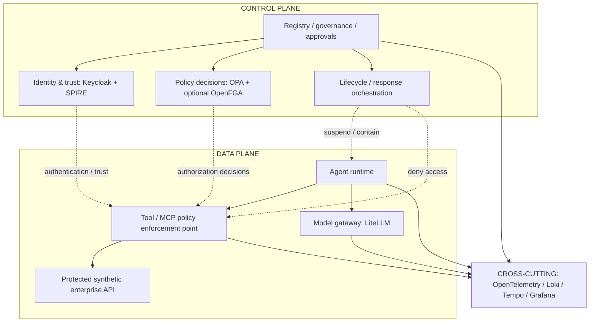

# Reference architecture

The architecture has a **governance/lifecycle**, **identity/trust**, and **policy/authorization** control plane; an **agent execution/data plane**; and **cross-cutting observability and response**.

See [control plane vs data plane](control-plane-vs-data-plane.md) for precise responsibilities and failure modes, and [agent lifecycle](agent-lifecycle.md) for the chronological view.

### Important deployment details

- The gateway and protected API must reject direct bypass traffic.
- Policy decisions must be bound to the authenticated workload and requested resource.
- Registry approval is necessary but not sufficient for access.
- Revocation is not assumed instantaneous: measure time-to-denial and document residual risks from cached tokens or decisions.
- All example data is synthetic.
- Docker Compose is the baseline; Kubernetes extensions can be added later.
